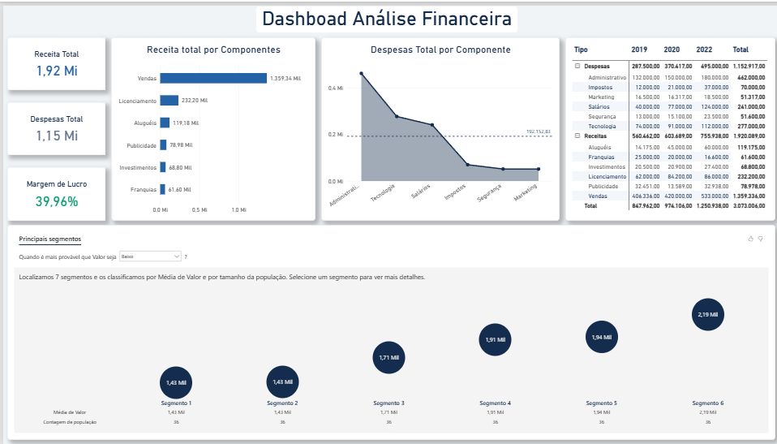

# 💰 Análise Financeira com Power BI

## 🎯 Sobre o projeto

Mini-projeto desenvolvido durante minha formação na **Data Science Academy (DSA)**, no curso *Microsoft Power BI para Business Intelligence e Data Science*, com o objetivo de analisar informações financeiras por meio de indicadores e visualizações interativas.

O desafio proposto consiste em desenvolver um dashboard que permita acompanhar receitas, despesas e margem de lucro de uma empresa fictícia, além de explorar o desempenho financeiro por componente, ano e segmento.

O projeto busca transformar dados financeiros em informações que auxiliem na compreensão dos resultados e na identificação de oportunidades para o planejamento estratégico.

**Observação:** os dados utilizados neste projeto são fictícios e fazem parte do exercício proposto pela DSA.

## 🛠️ Ferramenta utilizada

- Power BI Desktop

## 📈 Indicadores e análises

O dashboard foi desenvolvido para responder às principais perguntas de negócio relacionadas ao desempenho financeiro da empresa.

### 💵 Indicadores financeiros

- Receita total;
- Despesas totais;
- Margem de lucro.

### 📊 Análise de receitas

- Total de receitas por componente;
- Comparação entre os diferentes componentes de receita;
- Identificação dos componentes com maior participação na receita total.

### 📉 Análise de despesas

- Total de despesas por componente;
- Comparação das despesas com a média geral;
- Identificação dos componentes que apresentam maiores e menores despesas.

### 📅 Análise financeira por período

- Receitas por componente e ano;
- Despesas por componente e ano;
- Comparação dos resultados financeiros ao longo dos períodos;
- Hierarquia de navegação entre Tipo e Componente.

### 🎯 Análise de segmentos

- Identificação de segmentos com maiores e menores valores;
- Classificação dos segmentos considerando a média de valor e o tamanho da população;
- Exploração dos segmentos para apoiar análises estratégicas.

## 📊 Visualizações utilizadas

Foram utilizadas diferentes visualizações do Power BI para facilitar a interpretação dos dados:

- **Cards:** apresentação da receita total, despesas totais e margem de lucro;
- **Gráfico de barras horizontais:** comparação das receitas por componente;
- **Gráfico de área:** análise das despesas por componente em relação à média;
- **Matriz:** detalhamento das receitas e despesas por tipo, componente e ano;
- **Visual de análise de segmentos:** identificação e exploração de grupos com diferentes características e valores.

## 🎛️ Interatividade

O dashboard permite explorar os dados financeiros por meio de recursos interativos, possibilitando:

- Análise dos componentes de receitas e despesas;
- Navegação pela hierarquia Tipo/Componente;
- Comparação dos resultados entre diferentes anos;
- Exploração dos segmentos identificados no conjunto de dados.

## 🔎 Principais informações

Com base nos resultados apresentados no dashboard, destacam-se:

- **1,92 milhão** em receita total;
- **1,15 milhão** em despesas totais;
- **39,96%** de margem de lucro.

O dashboard também permite observar a participação dos diferentes componentes na composição das receitas e despesas, identificar componentes com despesas acima ou abaixo da média e explorar segmentos com diferentes valores financeiros.

Essas análises permitem compreender melhor a composição dos resultados financeiros e oferecem informações que podem auxiliar no planejamento estratégico da empresa.

## 🖼️ Dashboard

## 🎓 Contexto

Projeto desenvolvido como parte da formação em **Análise de Dados pela Data Science Academy (DSA)**, explorando funcionalidades do Power BI aplicadas ao contexto financeiro.

## 👨‍💻 Autor

**Vinicius Marques**

Análise e Desenvolvimento de Sistemas | Power BI | Excel | SQL | Análise de Dados
